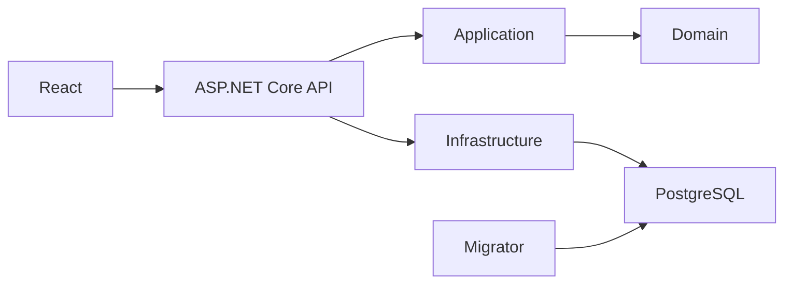

# Architecture

`backend/src` contains Domain, Application, Infrastructure, API, and Migrator projects. React/Vite lives in `frontend`. EF Core migrations are in Infrastructure. Cash operations, transfers, shifts, settlements, and reports are implemented as separate API routes/services. The documented invariants must be checked against transaction code and disposable PostgreSQL tests before treating this as a production financial system.
