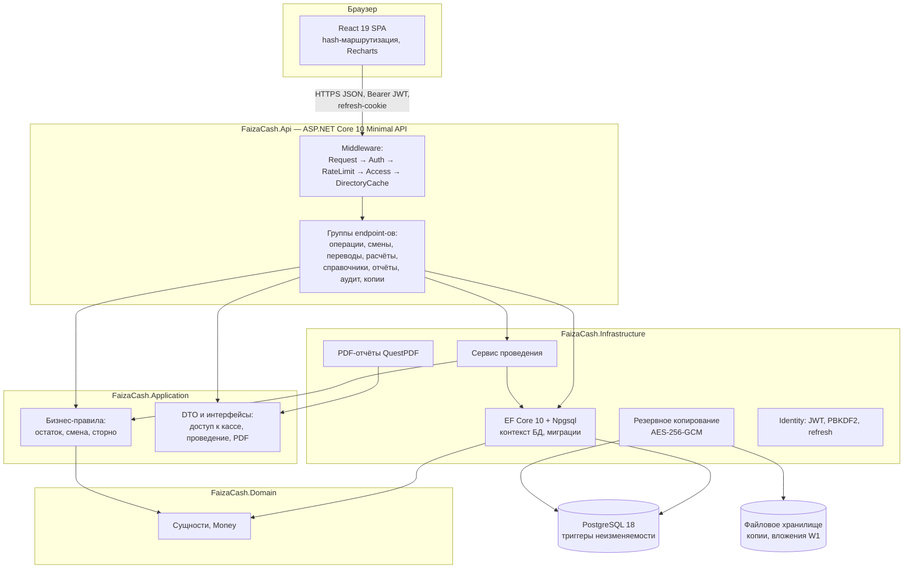
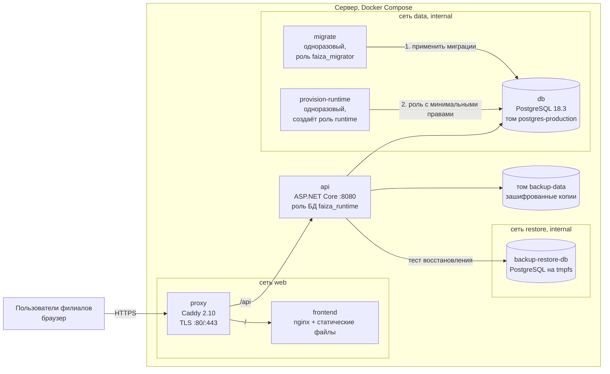

# Архитектура и развёртывание

## Логическая архитектура (слои)

Зависимости направлены внутрь: `Api → Infrastructure → Application → Domain`. Domain не зависит ни от чего.

## Развёртывание (production Compose)

Порядок запуска: `db` (healthy) → `migrate` (успешно завершён) → `provision-runtime` (успешно завершён) → `api` (вместе с healthy `backup-restore-db`) → `frontend`, `proxy`. API не стартует при неприменённых миграциях. Сети `data` и `restore` внутренние — база недоступна извне.

Для вложений волны 1 (ADR 0008) потребуется отдельный том, смонтированный в контейнер `api`; его добавляет агент backend (`docker-compose.production.yml` вне зоны документации).
