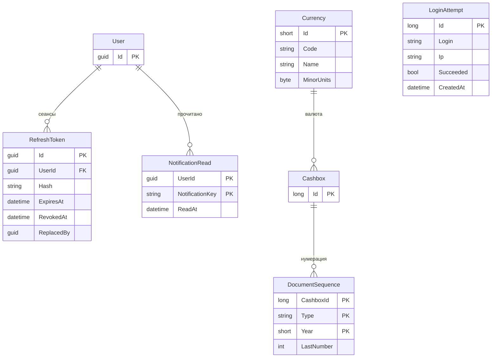

# ER-диаграмма основных сущностей

Построена по модели предметной области базовой версии и API-контракту волны 1. Сущности и поля волны 1 помечены комментарием **«W1»** (целевое состояние, реализуется в ветке backend; имена сущностей волны 1 — рабочие, окончательные определит реализация).

Служебные таблицы (`RefreshToken`, `LoginAttempt`, `DocumentSequence`, `NotificationRead`, `Currency`) показаны на отдельной диаграмме ниже, чтобы основная читалась на одной странице.

## Основная диаграмма

```mermaid
erDiagram
    Organization {
        int Id PK
        string Name
        string Currency
        string TimeZone
        decimal ExpenseApprovalThreshold "W1, null = выключено"
        string LogoPath "W1"
    }
    Branch {
        long Id PK
        string Code
        string Name
        string City
        bool Active
    }
    Cashbox {
        long Id PK
        string Code
        string Name
        long BranchId FK
        short CurrencyId FK
        decimal BalanceLimit "nullable"
        bool Active
    }
    CashboxOpening {
        long Id PK
        long CashboxId FK
        date Date
        decimal Amount
    }
    User {
        guid Id PK
        string Login
        string FullName
        bool Active
        bool MustChangePassword
        string AvatarPath "W1"
    }
    Role {
        short Id PK
        string Code
    }
    UserRole {
        guid UserId FK
        short RoleId FK
    }
    CashAccess {
        guid UserId FK
        long CashboxId FK
    }
    Category {
        long Id PK
        string Type "income | expense"
        long ParentId FK
        string Name
        bool Active
        bool IsSystem "W1"
    }
    Counterparty {
        long Id PK
        string Name
        string Kind "client | supplier | employee | other"
        string TaxCode
        bool Active
    }
    DocumentType {
        short Id PK
        string Code
        string Name
    }
    CashOperation {
        long Id PK
        long CashboxId FK
        date Date
        string Type "income | expense"
        string Status "draft | posted"
        decimal Amount
        long CategoryId FK
        long CounterpartyId FK
        short DocumentTypeId FK
        string DocumentNumber
        long ShiftId FK
        long PostingSeq
        bool IsReversal
        long ReversalOfId FK
        long ReversalId FK
        long TransferId FK
        guid RequestKey
        guid CreatedBy FK
        guid PostedBy FK
        int Version
        string ApprovalStatus "W1 none | pending | approved | rejected"
        guid ApprovedBy "W1"
        datetime ApprovedAt "W1"
        string ApprovalComment "W1"
    }
    CashShift {
        long Id PK
        long CashboxId FK
        date Date
        string Status "open | closed"
        decimal OpeningBalance
        decimal ClosingBalance
        decimal ClosingDifference
    }
    ShiftDenomination {
        long ShiftId FK "W1"
        decimal Value "W1"
        int Count "W1"
    }
    CashTransfer {
        long Id PK
        long SourceCashboxId FK
        long TargetCashboxId FK
        date Date
        decimal Amount
        long SourceOperationId FK
        long TargetOperationId FK
    }
    Settlement {
        long Id PK
        long CashboxId FK
        long CounterpartyId FK
        guid RepresentativeId FK
        string Direction "receivable | payable"
        decimal TotalAmount
        decimal PaidAmount
        string Status
        date DueDate
    }
    PaymentAllocation {
        long Id PK
        long SettlementId FK
        long OperationId FK
        decimal Amount
    }
    RepresentativeReceipt {
        long Id PK
        guid RepresentativeId FK
        long CounterpartyId FK
        long CashboxId FK
        decimal Amount
        string Status "collected | handed_over | accepted | cancelled"
    }
    Advance {
        long Id PK "W1"
        long OperationId FK "W1 проведённый РКО"
        long CounterpartyId FK "W1 employee"
        decimal Amount "W1"
        string Purpose "W1"
        date DueDate "W1"
        string Status "W1 issued | reported | closed"
        long SettleOperationId FK "W1"
    }
    AdvanceReportLine {
        long Id PK "W1"
        long AdvanceId FK "W1"
        date Date "W1"
        string Description "W1"
        decimal Amount "W1"
        long CategoryId FK "W1"
    }
    Attachment {
        guid Id PK "W1"
        string OwnerType "W1 operation | receipt | advance"
        long OwnerId "W1"
        string FileName "W1"
        string ContentType "W1"
        long SizeBytes "W1"
        string Sha256 "W1"
        guid UploadedBy FK "W1"
        datetime UploadedAt "W1"
    }
    CashInventory {
        long Id PK "W1 append-only"
        long CashboxId FK "W1"
        datetime CreatedAt "W1"
        decimal ActualAmount "W1"
        decimal ExpectedAmount "W1"
        decimal Difference "W1"
        string Commission "W1 JSON список ФИО"
        string Note "W1"
    }
    CashInventoryLine {
        long InventoryId FK "W1"
        decimal Value "W1"
        int Count "W1"
    }
    Denomination {
        string Currency "W1"
        decimal Value "W1"
        string Kind "W1 banknote | coin"
    }
    ExchangeRate {
        string Currency "W1"
        date Date "W1"
        decimal RateToBase "W1"
    }
    AuditEvent {
        long Id PK "append-only"
        guid UserId FK
        string Action
        string Entity
        long EntityId
        string Details
        datetime CreatedAt
    }

    Branch ||--o{ Cashbox : "включает"
    Cashbox ||--o| CashboxOpening : "начальный остаток"
    Cashbox ||--o{ CashShift : "смены"
    Cashbox ||--o{ CashOperation : "документы"
    Cashbox ||--o{ CashAccess : "доступ"
    User ||--o{ CashAccess : "имеет"
    User ||--o{ UserRole : "имеет"
    Role ||--o{ UserRole : "назначена"
    User ||--o{ CashOperation : "автор"
    Category ||--o{ CashOperation : "классифицирует"
    Category ||--o{ Category : "родитель"
    Counterparty ||--o{ CashOperation : "реквизит"
    DocumentType ||--o{ CashOperation : "основание"
    CashShift ||--o{ CashOperation : "проведено в смене"
    CashShift ||--o{ ShiftDenomination : "пересчёт W1"
    CashOperation |o--o| CashOperation : "сторно"
    CashTransfer ||--|{ CashOperation : "пара РКО/ПКО"
    Counterparty ||--o{ Settlement : "должник/кредитор"
    Settlement ||--o{ PaymentAllocation : "оплаты"
    CashOperation ||--o{ PaymentAllocation : "распределена"
    Counterparty ||--o{ RepresentativeReceipt : "плательщик"
    Cashbox ||--o{ RepresentativeReceipt : "принимает"
    CashOperation ||--o| Advance : "выдача W1"
    Counterparty ||--o{ Advance : "подотчётное лицо W1"
    Advance ||--o{ AdvanceReportLine : "отчёт W1"
    Category ||--o{ AdvanceReportLine : "статья W1"
    CashOperation ||--o{ Attachment : "вложения W1"
    Cashbox ||--o{ CashInventory : "акты W1"
    CashInventory ||--|{ CashInventoryLine : "пересчёт W1"
    User ||--o{ AuditEvent : "действие"
```

Примечание: связь `Attachment` полиморфна (`OwnerType` + `OwnerId`) — вложение может принадлежать документу, квитанции или авансу; на диаграмме показана только связь с документом.

## Служебные сущности

