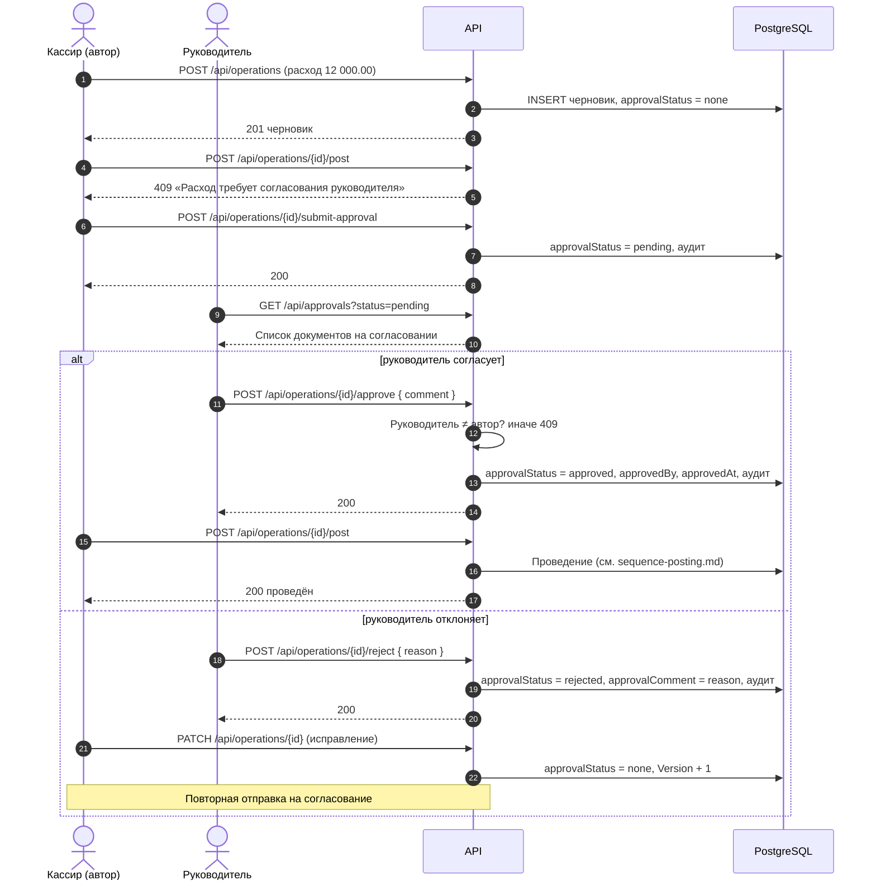
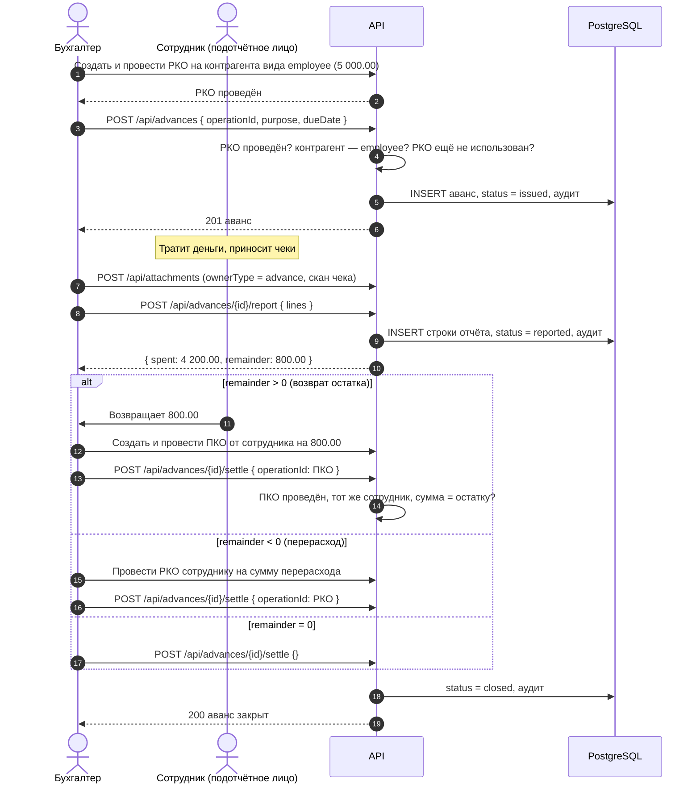

# Последовательности «Согласование расхода» и «Цикл аванса» (волна 1)

Целевое поведение по API-контракту волны 1.

## Согласование расхода

## Цикл аванса подотчётному лицу

Аванс в статусе `issued`, у которого срок отчёта раньше сегодняшней даты (Asia/Dushanbe), считается просроченным и учитывается в показателе `overdueAdvances` панели.
