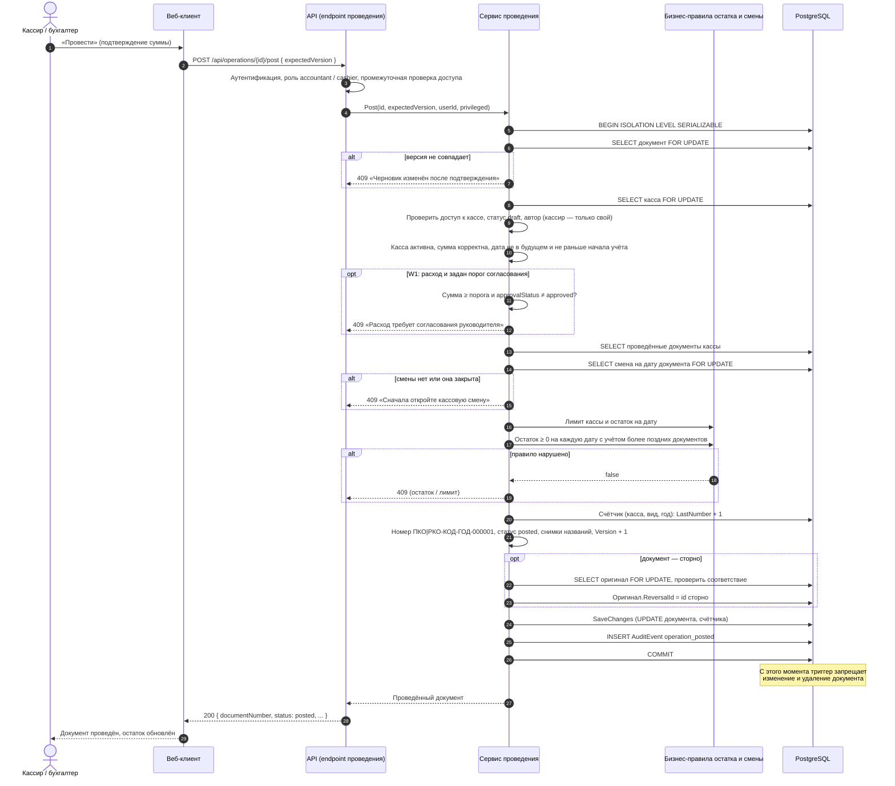

# Последовательность «Проведение кассового документа»

Отражает фактический порядок проверок сервиса проведения базовой версии плюс проверку согласования волны 1 (W1). Все шаги между `BEGIN` и `COMMIT` выполняются в одной транзакции уровня Serializable; при конфликте сериализации пользователь получает 409 и повторяет действие.

Если запись аудита не удалась, транзакция откатывается целиком: документ остаётся черновиком, счётчик номеров и остаток не меняются (это проверяется автоматическим тестом).
