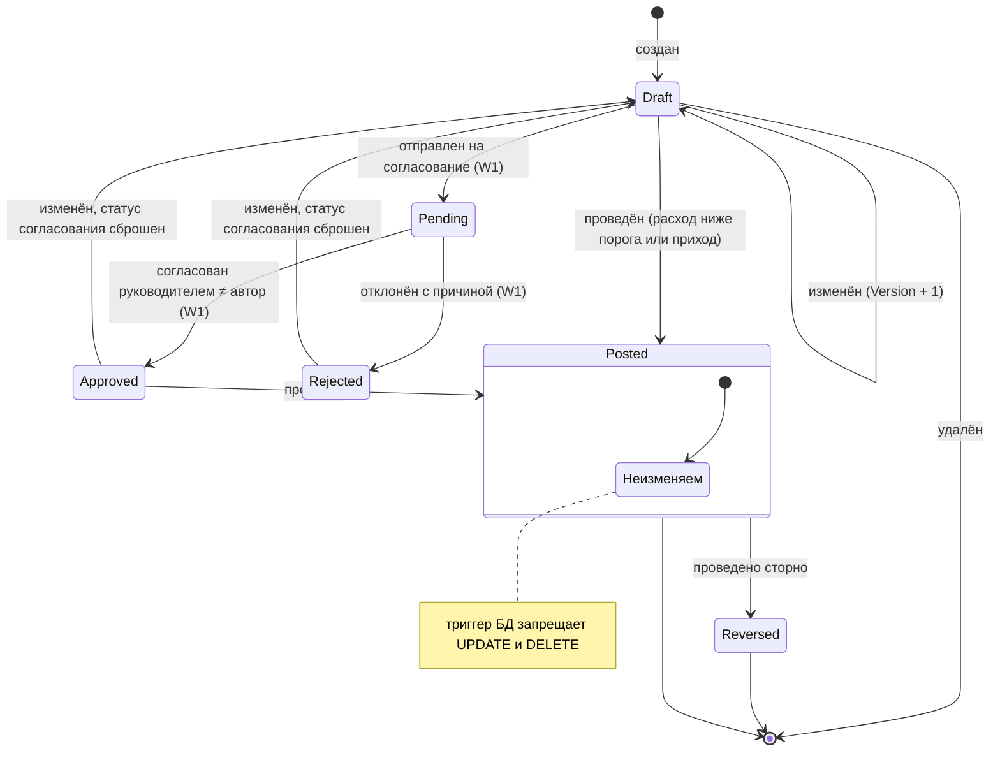
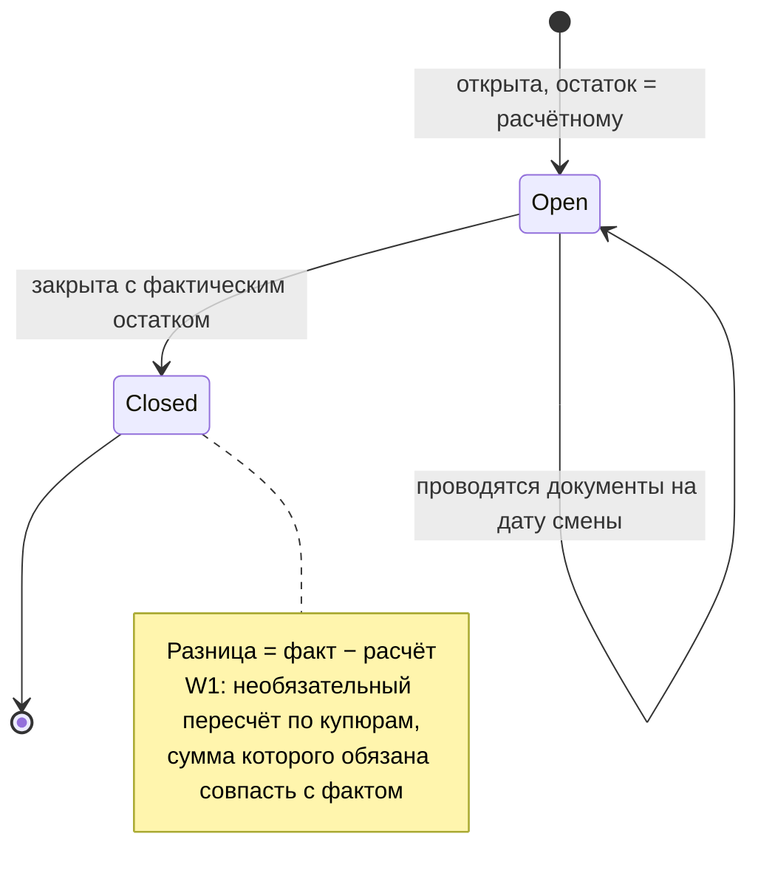
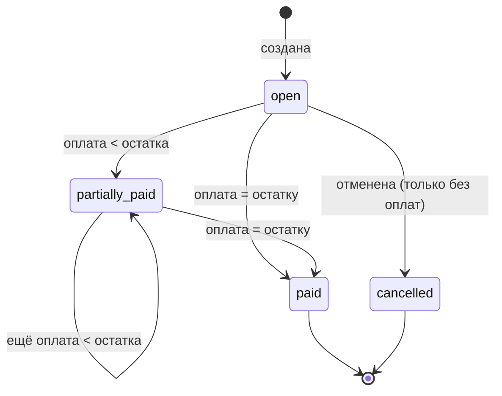
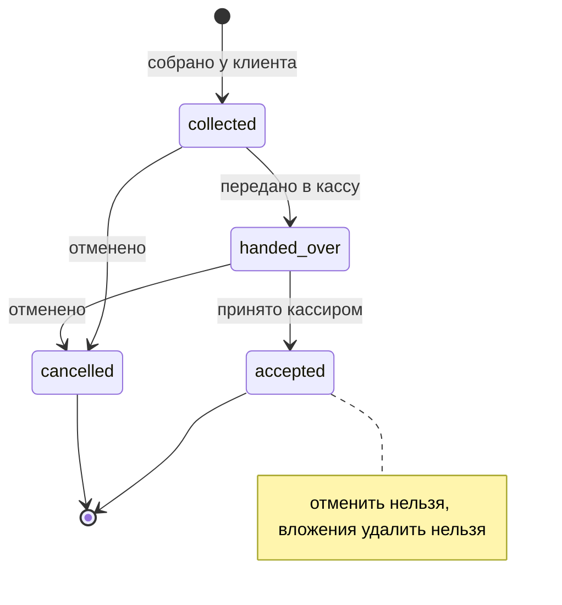
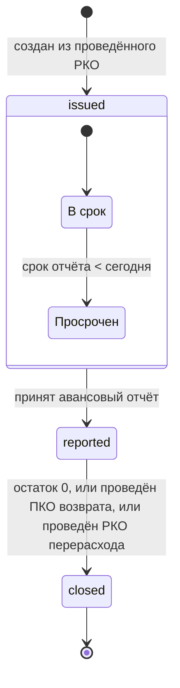

# Диаграммы состояний

## Кассовый документ

В модели статус проведения (`draft`/`posted`) и статус согласования (`none`/`pending`/`approved`/`rejected`, W1) — разные поля. Ниже они показаны как единый жизненный цикл, как его видит пользователь. Ветка согласования действует только для расходов с суммой не меньше порога.

## Кассовая смена

## Задолженность

## Квитанция торгового представителя

## Аванс подотчётному лицу (W1)

