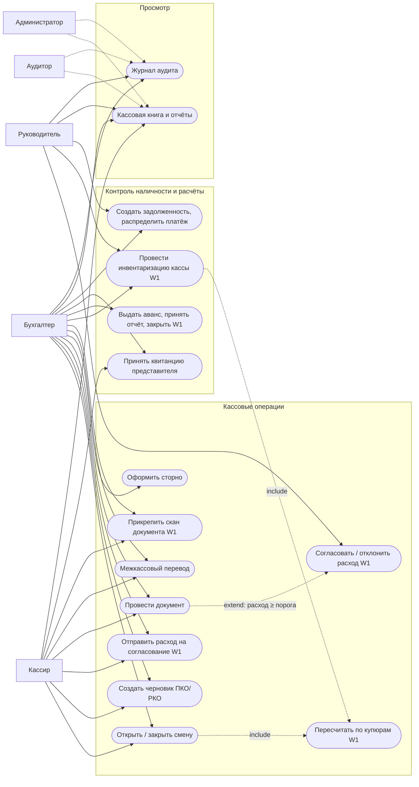
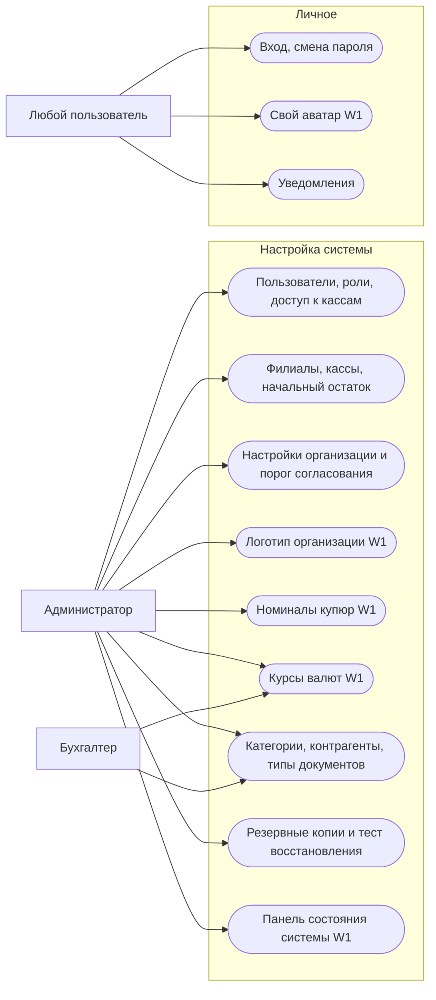

# Диаграмма вариантов использования

В Mermaid нет отдельного типа UML Use Case, поэтому диаграмма построена как граф: роли — прямоугольники слева, варианты использования — скруглённые узлы, сгруппированные по подсистемам. Права соответствуют приложению А ТЗ по ГОСТ 34.602-2020. Варианты волны 1 помечены «W1». Пунктир — только чтение.

## Финансовые операции

## Администрирование и личные настройки

Ключевое ограничение (разделение обязанностей): у администратора нет связей с вариантами из группы «Кассовые операции» и «Контроль наличности», кроме просмотра.
